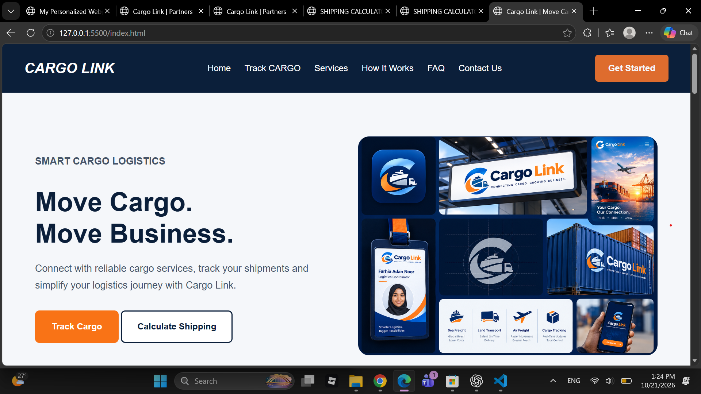
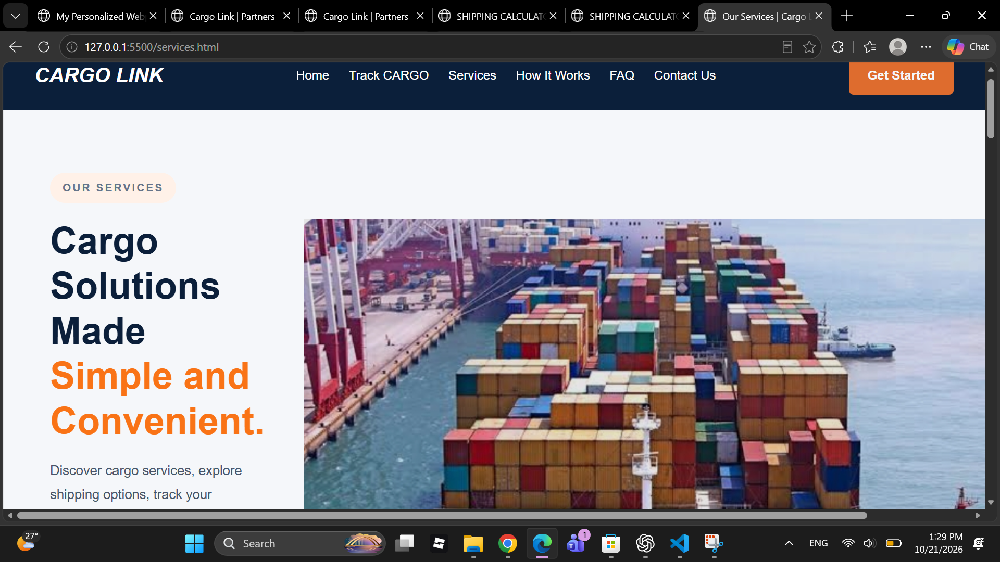
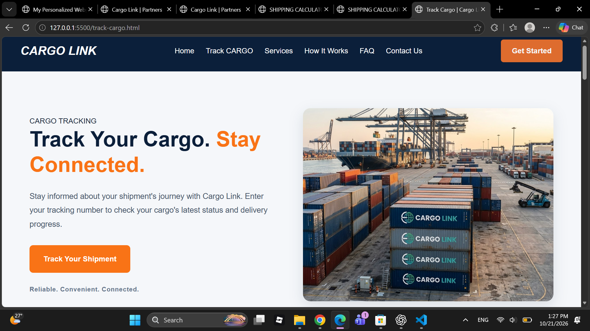
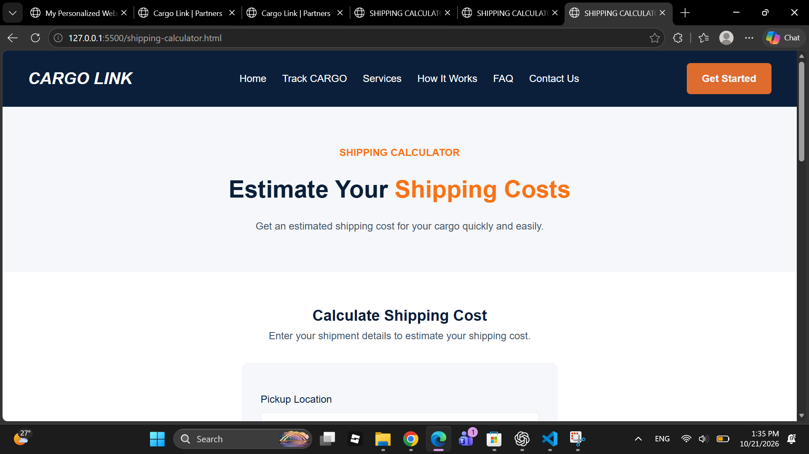
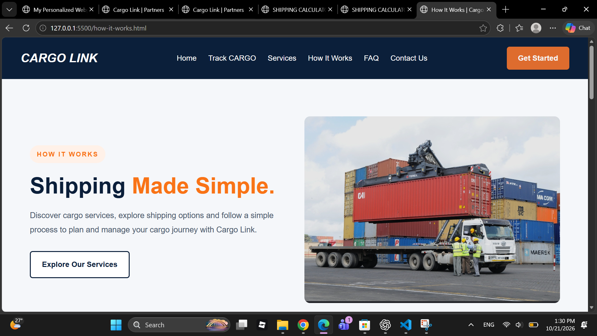

# Cargo Link — Move Cargo. Move Business.

## 1. Project Overview

Cargo Link is a logistics website prototype designed to connect customers with cargo and logistics service providers through one platform.

The project aims to make it easier for customers to discover cargo services, explore shipping options, access shipment-tracking resources, and estimate shipping costs. It also provides cargo businesses with an opportunity to showcase their services and improve their online visibility.

Cargo Link was developed as part of the Zindua School Web Development Module 1.

## 2. Problem Statement

Many customers experience difficulties finding reliable cargo service providers, accessing shipping information, and keeping track of their shipments.

At the same time, some cargo businesses struggle to market their services and reach potential customers online.

Cargo Link aims to address these challenges by providing a centralized platform where customers can explore logistics services and cargo businesses can showcase their offerings.

## 3. Project Objectives

The objectives of Cargo Link are to:

* Make cargo service providers easier to discover.
* Provide an interface for accessing shipment-tracking resources.
* Help users explore shipping cost estimation options.
* Present cargo and logistics services clearly.
* Improve the online visibility of cargo businesses.
* Create a user-friendly and responsive website.
* Apply HTML5 and CSS3 concepts in a practical project.

## 4. Target Users

Cargo Link is designed for:

* **Individuals:** People who need to transport packages or goods.
* **Businesses:** Companies that require cargo transportation and delivery services.
* **Cargo Companies:** Logistics providers who want to showcase their services online.
* **Small Business Owners:** Entrepreneurs who need accessible shipping information and cargo solutions.

## 5. User Stories

User stories describe what users want to achieve when using Cargo Link.

1. **Finding cargo services:** As a customer, I want to explore available cargo services so that I can identify a suitable logistics provider.

2. **Tracking shipments:** As a customer, I want to enter my tracking number so that I can access the cargo-tracking interface.

3. **Estimating shipping costs:** As a customer, I want to enter my shipment details so that I can explore the shipping cost estimation process.

4. **Discovering cargo companies:** As a business owner, I want to explore cargo providers so that I can find suitable delivery options.

5. **Marketing cargo services:** As a cargo company, I want to showcase my services so that potential customers can learn about my business.

6. **Understanding the process:** As a first-time visitor, I want to understand how Cargo Link works so that I can navigate the website confidently.

7. **Finding answers:** As a customer, I want to read frequently asked questions so that I can understand the platform better.

8. **Contacting the company:** As a customer, I want to submit an inquiry so that I can request additional information.

## 6. Website Features

* **Homepage:** Introduces Cargo Link and its main services.
* **Cargo Tracking:** Provides a form for entering a shipment tracking number.
* **Shipping Calculator:** Allows users to enter shipment details for cost estimation.
* **Services Page:** Presents cargo and logistics services.
* **How It Works:** Explains how the platform works.
* **Partners Page:** Introduces opportunities for cargo businesses to connect with Cargo Link.
* **Company Profile:** Presents information about the company and its purpose.
* **FAQ Page:** Provides answers to common questions.
* **Contact Page:** Provides contact information and an inquiry form.
* **Contact Confirmation Page:** Displays a confirmation message after the contact form demonstration.
* **Responsive Design:** Uses CSS media queries to help the website adapt to different screen sizes.

**Feature limitations:** Cargo tracking, automatic shipping cost calculations, and actual message delivery require additional functionality. These features should be described as fully functional only if the required functionality has been implemented and tested.

## 7. Website Pages

| File Name                  | Description                                       |
| -------------------------- | ------------------------------------------------- |
| `index.html`               | Homepage                                          |
| `track-cargo.html`         | Cargo tracking interface                          |
| `shipping-calculator.html` | Shipping cost estimation form                     |
| `services.html`            | Overview of cargo and logistics services          |
| `how-it-works.html`        | Explanation of how Cargo Link works               |
| `partners.html`            | Information for potential cargo business partners |
| `company-profile.html`     | Company information, mission, and vision          |
| `faq.html`                 | Frequently asked questions                        |
| `contact.html`             | Contact information and inquiry form              |
| `contact-success.html`     | Contact form confirmation page                    |

Make sure the filenames in this table match the files in your project. Add a separate partner profile page if you have created one.

## 8. Technologies Used

* **HTML5:** Structures the website content.
* **CSS3:** Styles the website, including layouts, colors, buttons, cards, hover effects, and responsive design.
* **Git:** Tracks changes during development.
* **GitHub:** Hosts the project repository and supports version control.

## 9. Design and Branding

Cargo Link uses a clean, modern design intended to communicate trust, simplicity, and efficiency.

### Color Palette

| Color      | Hex Code  | Purpose                       |
| ---------- | --------- | ----------------------------- |
| Navy Blue  | `#0B1F3A` | Branding and headings         |
| Light Grey | `#F5F7FA` | Section backgrounds           |
| Slate Grey | `#475569` | Body text                     |
| White      | `#FFFFFF` | Cards and content backgrounds |

### Design Principles

* Simple navigation.
* Consistent colors and typography.
* Clear calls to action.
* Card-based layouts.
* Responsive page layouts.
* Readable content.
* Descriptive image alternative text.
* Appropriately labelled form fields.

## 10. Screenshots

Screenshots provide a visual preview of the Cargo Link website.

The screenshots in this section should be captured from the actual website.

### Homepage



### Services Page



### Cargo Tracking Page



### Shipping Calculator



### How It Works Page



### Contact Page


Save the corresponding image files in a folder named `screenshots` in the main project directory. The image filenames in this section must match the actual files.

## 11. Project Structure

The project is organized into HTML pages, a CSS stylesheet, and folders for images and screenshots.

```text
cargo-link/
├── index.html
├── track-cargo.html
├── shipping-calculator.html
├── services.html
├── how-it-works.html
├── partners.html
├── company-profile.html
├── faq.html
├── contact.html
├── contact-success.html
├── style.css
├── README.md
├── images/
│   ├── how-it-works.jpeg
│   ├── service-her0.jpeg
│   ├── tracking-hero.jpeg
│   └── cargo-tracking.jpeg
└── screenshots/
    ├── homepage.png
    ├── services.png
    ├── tracking.png
    ├── shipping-calculator.png
    ├── howitworks.png
    └── contacts.png
```

This is an example structure. Update it to match the actual files and folders in your project.

## 12. Installation and Setup

To view the project locally:

1. Clone the GitHub repository:

   ```bash
   git clone https://github.com/farhia32/cargo-link
   ```

2. Open the project folder:

   ```bash
   cd cargo-link
   ```

   Replace `cargo-link` with your actual folder name if it is different.

3. Open the project in Visual Studio Code.

4. Open `index.html` in your browser or use the Live Server extension in VS Code.

No backend setup is required to view the current front-end prototype.

## 13. Responsive Design

Cargo Link uses CSS media queries to help the website adapt to different screen sizes.

The responsive design aims to ensure that:

* Navigation fits smaller screens.
* Cards stack appropriately on mobile devices.
* Text remains readable.
* Forms fit within the available screen width.
* Buttons remain easy to use.
* Content does not overflow horizontally.

These behaviors should be tested on desktop, tablet, and mobile-sized screens.

## 14. Testing

The following checks can be used to evaluate the website:

* Confirm that all pages open correctly.
* Test navigation links.
* Check that images load correctly.
* Check that form fields have appropriate labels.
* Test required fields and input types.
* Check the website on different screen sizes.
* Look for overlapping elements and horizontal scrolling.
* Confirm that the contact confirmation page opens as intended.
* Check for spelling mistakes and inconsistent styling.

Only report tests as completed after testing them.

## 15. Future Improvements

Future development could include:

* Integrating real cargo tracking services or APIs.
* Implementing automatic shipping cost calculations.
* Adding a database for cargo companies and shipment information.
* Allowing cargo businesses to register and manage their profiles.
* Adding user registration and login functionality.
* Connecting the contact form to a backend or form service.
* Introducing search and filtering for cargo service providers.
* Providing more detailed shipment status updates.
* Improving accessibility and usability.

## 16. Learning Objectives

Through this project, I aim to strengthen my understanding of:

* HTML5 page structure.
* CSS3 styling and layouts.
* Responsive design principles.
* Consistent styling across multiple pages.
* Organizing project files and assets.
* Using Git and GitHub for version control.
* Writing user stories based on user needs.
* Documenting a web development project.
* Building a website prototype that addresses a real-world problem.

## 17. Author

**Farhia Adan**

Zindua School — Web Development Module 1

## 18. License

This project was created for educational purposes.

Any third-party images, icons, or other assets used in the project remain subject to their respective licenses.
